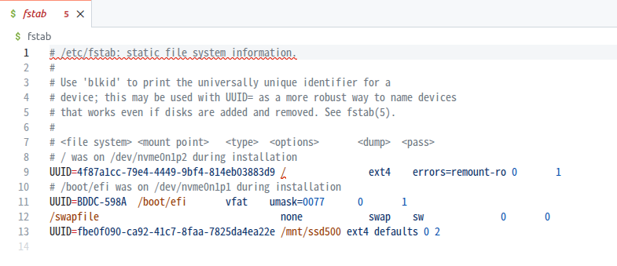

## 공부 배경
- 최근 저장 용량 문제로 리눅스 컴퓨터 본체에 SSD 추가함
- SSD를 추가했는데 파일 시스템에 보이지 않았음
- 리눅스에서 새로 추가한 SSD를 보기 위해서는 **마운트(mount)**라는 작업을 진행해야한다고함
- 이에 마운트라는 개념을 공부하고 정리해보고자함


## 마운트란? 

파일 시스템과 디스크를 연결하는 과정

Disk를 물리적으로 추가하고 현재 파일 시스템에서 사용하려면 마운트를 진행해야함


```shell
mount /dev/sda1 /mnt/ssd500
```
명령어 자체는 간단한데 


## ISSUE!!
- 리눅스를 재부팅하고 나니 SSD가 보이지 않는 문제가 발생
- 마운트 옵션을 리부트 후에도 유지하려면 /etc/fstab 파일에 마운트 정보 등록해야함
- 마지막줄에 마운트하고자 하는 내용 추가하면됨
- 이때 기존 내용 수정하지 않도록 조심하기
- 혹시 모르니까 수정 전에 백업본 만들어두기 



여기서 UUID는 디스크나 파티션을 식별하기 위한 값

이렇게 /etc에 설정을 추가해놔야 나중에 리누스 리부트했을 때 마운트 설정이 자동으로 됨

/etc 는 시스템 및 프로그램의 설정 파일(Configuration File)을 저장하는 디렉토리

그 중 fstab(디스크 및 파티션 마운트 설정)이랑 hostname(컴퓨터 호스트 이름 설정)의 경우 부팅 중에 읽어와서 사용됨

나중에 관련내용으로 블로그 써보자. 


## 궁금한 점

그러면 부팅할 때 etc/fstab을 읽어오는건 알겠는데 누가 실행시키는거지? 

Ubuntu 22.04에서는 systemd가 실행해줌

#### systemd
https://systemd.io/
https://docs.redhat.com/ko/documentation/red_hat_enterprise_linux/7/html/system_administrators_guide/chap-managing_services_with_systemd

리눅스 운영체제의 초기화 시스템이자 시스템 및 서비스 관리자. 

커널이 부팅된 후 가장 먼저 실행되는 메인 프로세스(PID 1)

부팅 시 서비스를 병렬로 실행하여 부팅 시간을 크게 줄여줌


### GPU SOS

1. Bootloader , Kernel : OS를 메모리에 적제하고 실행
2. initramfs : 실제 루트 파일 시스템(/)을 찾아 마운트
3. systemd : 설정 파일을 기반으로 나머지 파일 시스템, 서비스 초기화


#### 더 공부해야할거
데몬

systemd

NVMe Driver 

/run

Unit file 

/proc/cmdline

BOOT_IMAGE

VFS

Driver

Block I/O


